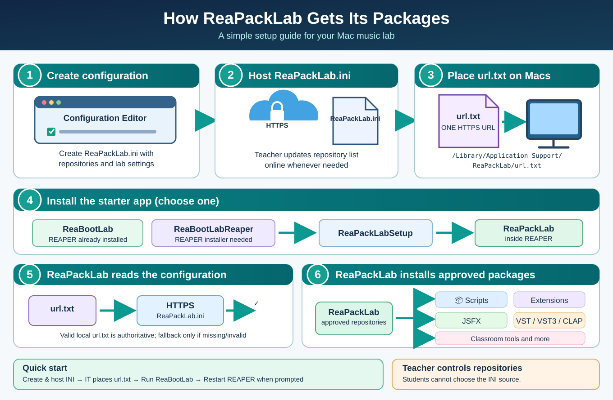

# ReaPackLab

**ReaPackLab** is the release repository for the centrally managed REAPER package manager in the ReaLab project, based on ReaPack by Christian Fillion.

**Current stable release: [v0.14.5](https://github.com/rockumk/ReaPackLab/releases/tag/v0.14.5)** — macOS 15.0 or later, Apple Silicon (ARM64). The binary embeds version **0.14.5** and is Developer ID Application signed, securely timestamped, built with hardened runtime, and Apple notarized. Other platforms are not listed in this distribution.

## Visual setup guide



To get started, use the [ReaPackLab configuration editor](https://rockumk.github.io/ReaPackLab-Config/ReaPackLab_Admin.html) to create `ReaPackLab.ini`, host it at an HTTPS URL, and ask IT to place **that single URL** in `/Library/Application Support/ReaPackLab/url.txt` on each Mac. Install through [ReaBootLab](https://github.com/rockumk/ReaBootLab) and restart REAPER when prompted. The teacher can update the hosted INI's repository list without involving IT again.

The separate [ReaPackLabSetup](https://github.com/rockumk/ReaPackLabSetup) bootstrap companion has its own version and feed. It is not included in the main binary.

## Security and verification

**Signed and Apple notarized.** Apple's Accepted submission and exact ARM64 code ticket were verified, together with the final signature and online notarization-ticket lookup. This does not establish end-to-end installation behavior on every Mac; macOS warnings may still occur. Test the downloaded, quarantined extension in an isolated REAPER resource directory before classroom or wider deployment. No Gatekeeper bypass is part of installation.

Each new release includes the dylib, `ReaPackLab-SHA256SUMS.txt`, and `ReaPackLab-provenance.json`, recording the final signed-byte hash and build identity. Existing releases remain unchanged. The binaries in older release tags retain their original signatures and embedded versions.

Final v0.14.5 binary SHA-256: `7dbde2c7fc0f12d5066d883850945131f577c09f26796ff6dd1c1cc61d7ca7e7`.

## Version 0.14.5

- Restore local-first configuration on standard macOS installations. A valid HTTPS pointer in `/Library/Application Support/ReaPackLab/url.txt` is authoritative; the hosted recovery pointer is consulted only if the local file is missing, unreadable or invalid.
- Do not switch to the recovery pointer after a selected local URL fails to download or its hosted configuration fails validation. Status reporting identifies the selected local/fallback source and fallback errors.
- Attempt an eligible full managed scan once per REAPER launch even when applied revisions are current. Unchanged five-minute policy checks do not repeat an already-attempted scan. A list/sync revision change, explicit Force Scan or new REAPER launch permits another attempt.
- Rename the existing Force Sync action/menu label to **Force Scan**, preserving the `REAPACKLAB_FORCE_SYNC` command ID.

This main-extension release does not change ReaPackLabSetup or ReaBootLab. Development source commit: `0710bb8e187812a28df5d89e5361dccdbb0f28f2`; original build run: `43965114820`.

## Repository folder names

New/unowned approved repositories use their readable index names for Scripts and Effects. Existing installed registry owners, including earlier `Repository-…` names, are preserved; this update does not automatically rename or migrate old folders. Deleting only folders does not reset recorded ownership. Test fresh naming in a separate REAPER resource directory rather than deleting a working registry.

Mac case/Unicode namespace collisions are checked before new identities become writable, and partial discovery failures do not keep revoked subscriptions enabled. Full live-REAPER installation/restart behavior still needs isolated testing.

## Repository / installation

ReaPack repository index URL:

```text
https://raw.githubusercontent.com/rockumk/ReaPackLab/master/index.xml
```

Native extension metadata is maintained in `Extensions/ReaPackLab.ext`. Its active `@provides` entry selects the verified, versioned ARM64 release asset and installs it into REAPER's `UserPlugins` directory. Restart REAPER after installing or updating native extensions.

The index is generated automatically with [reapack-index](https://github.com/cfillion/reapack-index) after verified assets and package metadata are published. Generated package entries are not edited by hand; historical versions are retained. See [Extensions/README.md](Extensions/README.md) for packaging conventions. Documented platform examples are not a claim that those platforms have release assets.

## Development and scope

[ReaPackLabDev](https://github.com/rockumk/ReaPackLabDev) is the development repository (access restricted). This distribution repository and its automatic source archives contain packaging metadata, not the development source tree. Public provenance records identify the exact development commit and Actions build without publishing private source or logs.

ReaPackLab is the managed package manager; ReaPackLabSetup is a separate bootstrap companion. Test installation and upgrades in isolated REAPER resources before using them with an existing managed installation.

## License and acknowledgments

ReaPackLab is derived from ReaPack by Christian Fillion. ReaPack is licensed under the GNU Lesser General Public License, version 3 or later. Derived source and binaries must retain the applicable license and attribution notices. Packaging tools and repository-format documentation are provided by the [ReaPack](https://github.com/cfillion/reapack-index) ecosystem.

ReaPackLab is an independent project and is not affiliated with Cockos, Inc.
